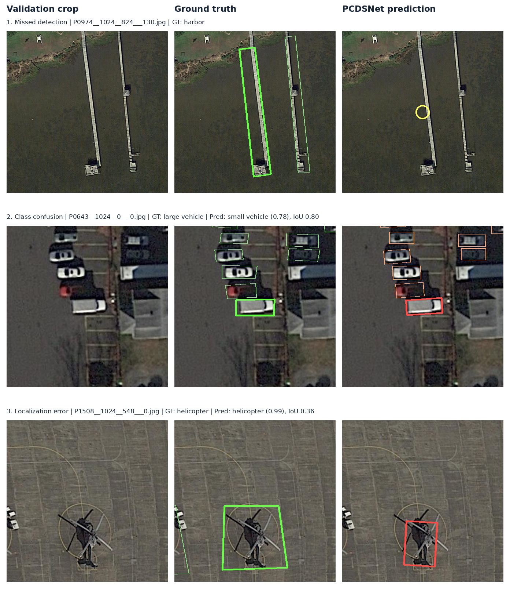
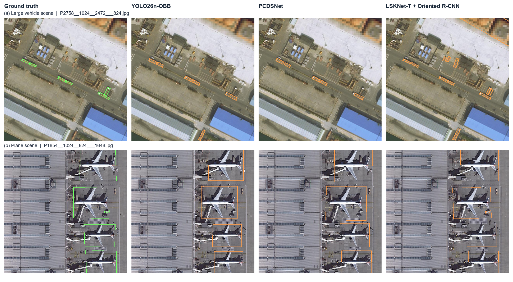

# Supplementary qualitative examples

We examined predictions from the PCDSNet checkpoint trained with seed 17 in a separate run on the DOTA-v1.0 validation split. Figure A.1 illustrates three failure cases selected from 160 inspected validation tiles. We used an input size setting of 1024 pixels and a prediction confidence threshold of 0.25.

In the first case, the detector misses an annotated harbor structure. In the second, it predicts a small vehicle for an annotated large vehicle, with a confidence of 0.78 and an oriented-box IoU of 0.80 with the annotation. In the third, it correctly classifies a helicopter with a confidence of 0.99, but its box covers only part of the annotated target, yielding an IoU of 0.36. These examples illustrate missed detections, class confusion, and localization errors.

Figure A.1: Representative PCDSNet failure cases. Columns show image crops, ground truth, and predictions. Boxes mark the discussed objects; the yellow circle indicates the missed harbor.

Figure A.2 compares two DOTA-v1.0 validation tiles using YOLO26n-OBB and PCDSNet from a separate seed-17 run and an official LSKNet-T + Oriented R-CNN checkpoint [14]. The LSKNet checkpoint was trained on DOTA trainval, potentially overlapping these tiles, and uses a different training and inference pipeline; the comparison is illustrative rather than matched.

Figure A.2: Qualitative comparison on two DOTA-v1.0 validation tiles. Columns show ground truth, YOLO26n-OBB, PCDSNet, and LSKNet-T + Oriented R-CNN predictions. The confidence threshold is 0.25; the LSKNet-T checkpoint was trained on trainval, which may include the shown tiles.
